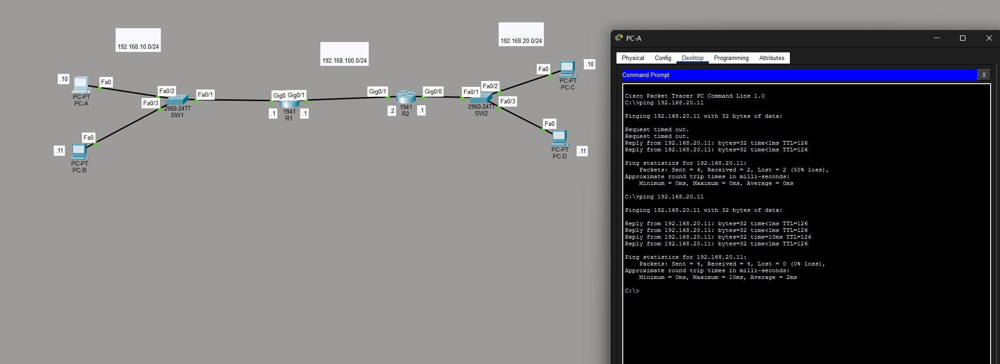
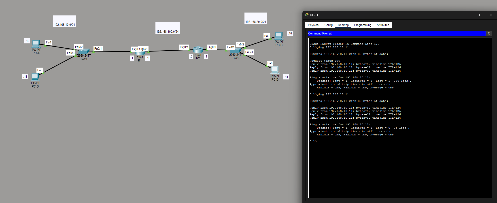

# Redes
# Laboratorio de Redes — Cisco Packet Tracer

## Descripción

Proyecto académico de diseño, configuración y simulación de una infraestructura de red utilizando Cisco Packet Tracer.

El laboratorio consiste en dos redes LAN interconectadas mediante dos routers Cisco 1941, permitiendo la comunicación entre dispositivos ubicados en diferentes segmentos de red mediante enrutamiento estático.

## Objetivo

Diseñar y configurar una topología de red que permita la comunicación entre dos redes locales, aplicando conocimientos de direccionamiento IPv4, configuración de dispositivos Cisco y enrutamiento estático.

## Topología de red

## Dispositivos utilizados

| Dispositivo | Modelo | Cantidad |
|---|---|---:|
| Router | Cisco 1941 | 2 |
| Switch | Cisco 2960-24TT | 2 |
| PC | Dispositivo final | 4 |

## Esquema de direccionamiento IP

| Segmento | Dirección de red | Máscara |
|---|---|---|
| LAN 1 | 192.168.10.0 | 255.255.255.0 |
| Interconexión de routers | 192.168.100.0 | 255.255.255.0 |
| LAN 2 | 192.168.20.0 | 255.255.255.0 |

### Direcciones de los dispositivos

**LAN 1**
- PC-A: 192.168.10.10
- PC-B: 192.168.10.11

**Interconexión entre routers**
- R1: 192.168.100.1
- R2: 192.168.100.2

**LAN 2**
- PC-C: 192.168.20.10
- PC-D: 192.168.20.11

## Configuraciones realizadas

- Diseño de topología LAN.
- Configuración de interfaces de routers.
- Asignación de direcciones IPv4 y máscaras de subred.
- Configuración de switches y dispositivos finales.
- Implementación de rutas estáticas.
- Configuración de contraseñas de acceso mediante consola.
- Aplicación de cifrado de contraseñas.
- Guardado de configuraciones para mantenerlas después del reinicio.

## Pruebas de conectividad

Se realizaron pruebas mediante el comando `ping` para verificar la comunicación entre dispositivos de diferentes redes.

Se comprobó la conectividad en ambos sentidos entre las redes LAN, validando el funcionamiento del enrutamiento estático.

## Tecnologías y herramientas

- Cisco Packet Tracer.
- Routers Cisco 1941.
- Switches Cisco 2960.
- IPv4.
- Enrutamiento estático.
- ICMP (ping).

## Competencias aplicadas

- Diseño de topologías de red.
- Configuración básica de routers y switches.
- Direccionamiento y segmentación IPv4.
- Enrutamiento entre redes.
- Configuración básica de seguridad en dispositivos Cisco.
- Diagnóstico y verificación de conectividad.

## Tipo de proyecto

Proyecto académico realizado con fines de aprendizaje y práctica de redes informáticas.